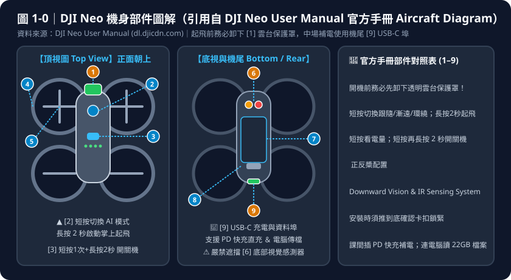
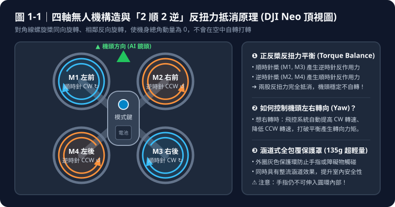
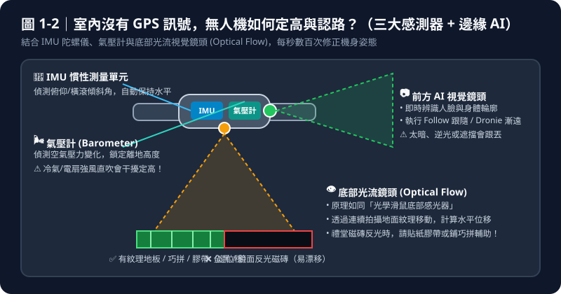
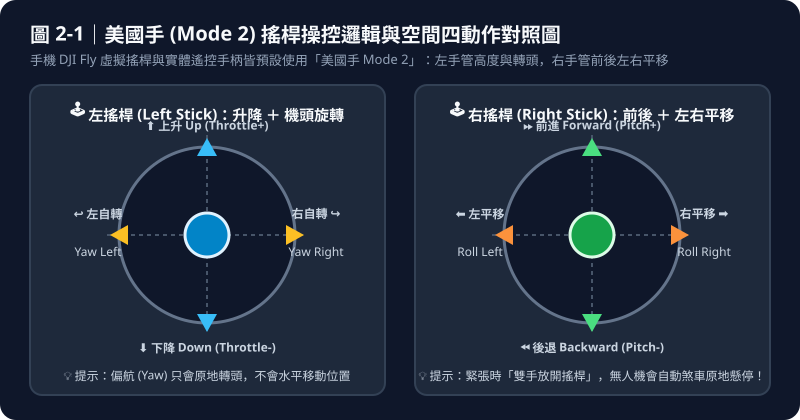
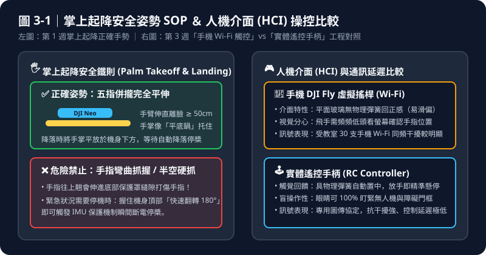

# 無人機資訊科技課程——學生分組學習單與評量規準

**組別 Group**：第 ____ 組　｜　**無人機編號 Drone ID**：`#0____`　｜　**日期 Date**：____ / ____

## 一、 團隊成員與角色輪替表 (Team Roles & Rotation)
> [!NOTE]
> 每次實作每 **10 分鐘** 輪替一次角色，每位同學都必須擔任過「飛手 Pilot」！

| 成員姓名 (Name) | 國家/母語 (Optional) | 第 1 週角色 | 第 2 週角色 | 第 3 週角色 | 第 4 週角色 |
| :--- | :--- | :--- | :--- | :--- | :--- |
| 1. | | | | | |
| 2. | | | | | |
| 3. | | | | | |
| 4. | | | | | |

**角色代號說明**：
- **P (Pilot 飛手)**：操作起降與執行飛行任務。
- **O (Observer 觀察員)**：盯緊機身高度、障礙物距離，喊出方向口令。
- **S (Safety 安全官)**：確認 1.5m 淨空、檢查電量、第一波飛完負責**插上中央快充站**、緊急狀況喊「STOP!」。
- **R (Recorder 紀錄員)**：記錄秒數、誤差數據、拍照與填寫學習單。

---

## 二、 第 1 週學習單：感測器系統與邊緣 AI 視覺測試





> **參考外部圖資與官方手冊 (Official Manual)**：
> - [DJI Neo User Manual 官方使用者手冊 (PDF 直連)](https://dl.djicdn.com/downloads/DJI_Neo/DJI_Neo_User_Manual_en.pdf) ｜ [DJI Neo 台灣官方下載中心](https://www.dji.com/tw/neo/downloads)
> - [Wikimedia Commons：四軸懸停推力平衡圖 (Quadrotorhover.svg)](https://commons.wikimedia.org/wiki/File:Quadrotorhover.svg)

### 1. 飛行前硬體檢查与課堂實作闖關 (In-Class Hands-on Checklist)
- [ ] **【實作 1-1】開機前檢查**：已卸下 `[1] 雲台保護罩`、4 顆螺旋槳保護罩無裂痕、`[6] 下視視覺感測器` 乾淨無遮擋
- [ ] **【實作 1-2】全員掌上起降**：組內 4 位同學皆完成「五指併攏完全平伸」掌上起飛與接機降落各 1 次
- [ ] **【實作 1-3】中場 PD 快充**：第一波實飛後正確長按 `[3] 電源鍵` 關機，並將機尾 `[9] USB-C 埠` 插上中央快充站補電

### 2. 感測器配對（請將感測器與其功能連線或寫出代號）
- **IMU（慣性測量單元）**：偵測機身 ________（A. 傾斜角度與加速度 / B. 離地高度 / C. 前方人臉）
- **Barometer（氣壓計）**：偵測機身 ________（A. 傾斜角度與加速度 / B. 垂直氣壓高度 / C. 水平位移）
- **Optical Flow（底部光流鏡頭）**：偵測機身 ________（A. 地面紋理水平移動 / B. 電池溫度 / C. Wi-Fi 訊號）

### 3. 邊緣 AI 視覺追蹤極限實驗 (Edge AI Tracking Experiment)
| 測試變因 (Test Variable) | 實驗設計（例：快跑、躲到柱子後、暗處） | AI 追蹤結果（成功 / 跟丟 / 延遲） | 資訊原理推測（光線/特徵點/遮擋） |
| :--- | :--- | :--- | :--- |
| **變因 1（速度）** | | | |
| **變因 2（遮擋）** | | | |
| **變因 3（光線/背景）** | | | |

### 4. 📝 第 1 週課後作業 (Take-Home Assignment 1)
1. **校園地面材質調查**：請在學校或家裡找出 1 個「最適合 `[6] 底部光流鏡頭` 定位的地面」與 1 個「會導致光流漂移失效的地面」，寫下地點與原因：
   - 適合定位的地面：________________________　原因：________________________
   - 容易失效的地面：________________________　原因：________________________
2. **課前準備**：請在個人手機安裝好 **DJI Fly App**，並完成課程網站 Unit 1 隨堂自我檢測。

---

## 三、 第 2 週學習單：無線通訊與飛行演算法設計




> **參考外部圖資**：
> - [Wikimedia Commons：飛行器三軸姿態角 (Flight_dynamics_with_text.svg)](https://commons.wikimedia.org/wiki/File:Flight_dynamics_with_text.svg)
> - [Wikimedia Commons：四軸偏航反扭力控制 (Quadrotoryaw.svg)](https://commons.wikimedia.org/wiki/File:Quadrotoryaw.svg)

### 1. 空間四動作與無線訊號
- **Wi-Fi 連線防呆**：我們這組連線的機身 SSID 尾碼是 `________`，使用頻段為 `[ ] 2.4GHz / [ ] 5.8GHz`。
- **控制變數配對**：
  - `Throttle (油門)`：上升 / 下降　｜　`Yaw (偏航)`：機頭左轉 / 右轉
  - `Pitch (俯仰)`：前進 / 後退　｜　`Roll (橫滾)`：向左 / 向右平移

### 2. 正方形巡航「演算法虛擬碼」與 Debug (Algorithm & Debugging)
請先寫下包含 **序列 (Sequence)**、**迴圈 (Loop)** 與 **條件修正 (If-Else)** 的虛擬碼，再進行實測與除錯：

```text
START
  Take off (起飛) -> Hover 2 seconds
  REPEAT 4 TIMES (重複 4 次):
      Move Forward (Pitch) ____ seconds
      IF 偏離路線 THEN 微調 Roll (左/右) ____ 秒
      Yaw Right 90° (右轉) ____ seconds
  END REPEAT
  Land (降落)
END
```

- **第一次測試結果與誤差**：____________________________________________________
- **Debug 修改參數（調整了哪個秒數？）**：_______________________________________

### 3. 🛠️ 第 2 週課堂實作闖關檢核 (In-Class Hands-on Checklist)
- [ ] **【實作 2-1】防連錯配對**：確認連上本組專屬編號 `#0____` Wi-Fi，未誤連他組飛機
- [ ] **【實作 2-2】正方形演算法 Debug**：依虛擬碼實飛 2 次，完成秒數參數修正
- [ ] **【實作 2-3】低空穿框挑戰**：使用手機虛擬搖桿穩定穿越 80cm 障礙門框至少 1 次

### 4. 📝 第 2 週課後作業 (Take-Home Assignment 2)
1. **線上模擬器實驗**：開啟課程網站「💻 資訊科技互動實驗室 ➔ 飛行演算法模擬器」，將偏航誤差調至 `15°`，比較勾選 `IF 偏航 THEN 微調修正` 前後的終點偏移距離：
   - 未勾選修正時偏移約 ______ cm；勾選修正後偏移約 ______ cm。
2. **思考題**：為什麼相同的前進秒數（例如 `Pitch 前進 2 秒`），在電池剛充飽（100%）與快沒電（25%）時飛出來的實際距離會不同？
   - 我們的推論：___________________________________________________________

---

## 四、 第 3 週學習單：人機介面 (HCI) 量化實驗與賽道設計



### 1. 實驗數據：手機觸控虛擬搖桿 vs. 實體遙控手柄 (HCI Comparison)
在相同的「S 型繞標 + 停機坪降落」關卡中，記錄兩者的量化數據：

| 控制介面 (Interface) | 完成時間 (秒) | 碰壁/出界次數 | 停機坪誤差 (cm) | 延遲感受 (1無延遲–5很延遲) |
| :--- | :--- | :--- | :--- | :--- |
| **手機 DJI Fly App (Wi-Fi)** | | | | |
| **實體遙控手柄 (Controller)** | | | | |

- **數據分析結論**：為什麼實體遙控手柄的失誤率或誤差通常較低？（提示：通訊協定穩定度、實體搖桿置中回饋、盲操作能力）
  _____________________________________________________________________________

### 2. 團隊賽道草圖 (Obstacle Course Sketch)
> 規範：門框寬度 ≥ 80 cm、離牆 ≥ 1.5 m、不可使用細線或網狀物。須標註起點、偵察區、終點。

```
（請在此繪製賽道俯視圖與關卡座標）


```

### 3. 🛠️ 第 3 週課堂實作闖關檢核 (In-Class Hands-on Checklist)
- [ ] **【實作 3-1】雙站 HCI 對照實測**：完成「手機觸控」與「實體遙控手柄」S 型繞標與停機坪降落數據紀錄
- [ ] **【實作 3-2】賽道搭建與安全檢驗**：搭建門框 ≥ 80cm、離牆 ≥ 1.5m 之障礙賽道，並完成試飛微調

### 4. 📝 第 3 週課後作業 (Take-Home Assignment 3)
1. **數據統計分析**：將全班「手機 vs. 手柄」秒數輸入課程網站「HCI 數據計算機」，計算實體手柄平均快了 ______ %。
2. **第 4 週決賽分工策略單**：
   - 階段一（雙門穿越）飛手：__________　｜　階段二＆三（AI 偵察＆降落）飛手：__________
   - 觀察員與安全官預計使用的多語/手勢口令：____________________________________

---

## 五、 第 4 週學習單：挑戰賽紀錄與資訊科技應用反思

### 1. 三階段接力挑戰賽成績與實作檢核
- [ ] **【實作 4-1】完成雙門穿越**：完成時間 ______ 秒　｜　失誤次數：______
- [ ] **【實作 4-2】匯出偵察密碼牌照片**：拍到的密碼牌國別/Passcode：________________
- [ ] **【實作 4-3】同心圓停機坪降落**：落點得分（圓心 30 分 / 中圈 20 分 / 外圈 10 分）：______ 分
- [ ] **【實作 4-4】完成 2 分鐘團隊成果短講**：展示偵察照片並說明 4 週 Debug 解決問題歷程

### 2. 📝 第 4 週期末作業：跨文化無人機應用提案 (Final Assignment)
無人機結合 AI 影像辨識與自動化巡航，在台灣或你的家鄉（越南 / 印尼 / 緬甸），最適合解決哪一種真實問題？（例如：湄公河稻田病蟲害辨識、台灣或緬甸山區地震搜救、印尼莊園巡檢）請寫下：
- **應用場景與國家/地區**：____________________________________________________
- **需要搭配的感測器或 AI 功能**：______________________________________________
- **預期解決的問題**：________________________________________________________

---

## 六、 教師評量規準 (Assessment Rubric - 資訊科技導向)

| 評量向度 | 優良 (3 分) | 良好 (2 分) | 待加強 (1 分) |
| :--- | :--- | :--- | :--- |
| **資訊科技原理與數據分析 (35%)** | 準確理解感測器、無線通訊干擾與 HCI 延遲差異；學習單虛擬碼具備迴圈與 Debug 修正紀錄。 | 大致能說出飛行感測與操控差異；學習單數據完整但推論較簡略。 | 僅停留於試飛娛樂，無法解釋誤差原因或虛擬碼空白。 |
| **安全規範與團隊協作 (25%)** | 嚴格遵守 1.5m 淨空與快充補電紀律；四角色確實輪替，主動使用多語圖卡或手勢協助隊友。 | 大部分時間遵守安全規範與角色輪替，能配合團隊指示。 | 曾出現未確認淨空即起飛等危險行為，或未落實換手。 |
| **飛行操控與任務達成 (25%)** | 能穩定控制懸停、穿框與精準降落；順利完成第 4 週三階段接力與清晰拍攝密碼牌。 | 能完成基本起降與部分障礙穿越，偶有偏航但能自行修正。 | 無法穩定控制高度或方向，多次碰撞障礙物導致中斷。 |
| **賽道工程與成果發表 (15%)** | 賽道兼顧安全與創意；發表能清楚呈現偵察影像並用數據說明 Debug 歷程。 | 賽道符合安全規範；能簡要說明團隊成果。 | 賽道忽略安全間距；發表內容過於簡略。 |
