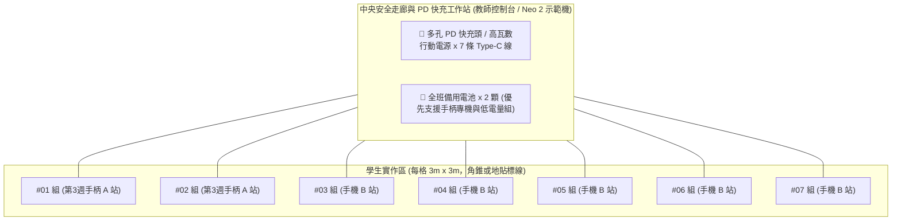
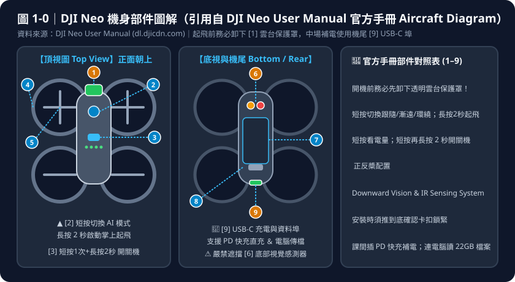
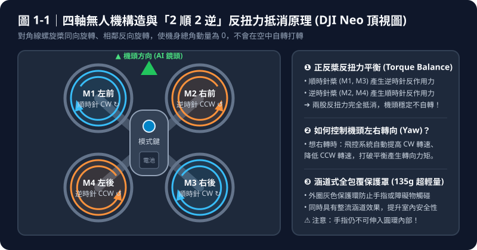
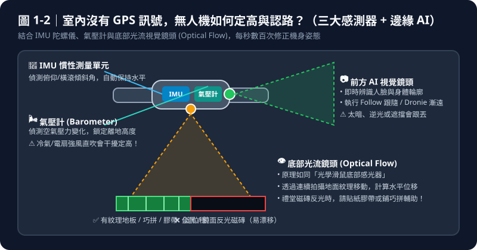
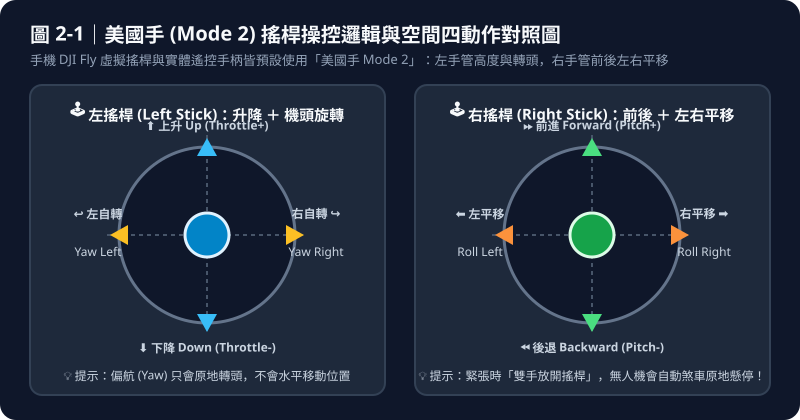
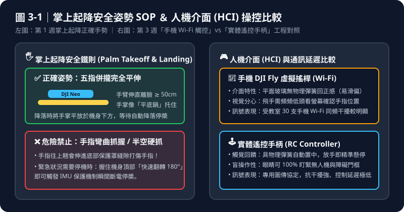

# 課堂簡報大綱與室內賽道設計指南（資訊科技 × 100 分鐘連排版）

## 一、 課堂教學簡報逐週大綱 (Slide Deck Outline)

教師可直接將以下各頁要點匯入 PowerPoint / Google Slides / Canva：

### Week 1：嵌入式系統、感測器與邊緣 AI 視覺
- **Slide 1**：課程封面「無人機與資訊科技｜Drone × IT」
- **Slide 2**：團隊四角色與 10 分鐘輪替規則（Pilot / Observer / Safety / Recorder）
- **Slide 3**：室內安全鐵則與多語口令/無聲手勢（中/英/越/印/緬）
- **Slide 4**：機體感測器解剖（IMU 姿態感測、氣壓計定高、底部光流鏡頭 Optical Flow）
- **Slide 5**：第一波實飛（12 分鐘）：掌上起降 + 內建 AI 模式（Follow / Dronie）
- **Slide 6**：**【中場快充 25 分鐘】** 邊緣 AI 視覺追蹤極限討論（變因設計：速度/遮擋/光線）
- **Slide 7**：第二波實飛（15 分鐘）：AI 極限測試與數據彙整

### Week 2：無線通訊架構與飛行演算法
- **Slide 8**：無線通訊小百科：2.4GHz vs 5.8GHz Wi-Fi 頻段與防連錯 SSID 規則
- **Slide 9**：空間控制變數（Mode 2）：Throttle / Yaw / Pitch / Roll
- **Slide 10**：第一波實飛（12 分鐘）：懸停與基礎轉向手感練習
- **Slide 11**：**【中場快充 25 分鐘】** 飛行虛擬碼 (Pseudocode) 編寫：序列 Sequence、迴圈 Repeat、條件修正 If-Else
- **Slide 12**：第二波實飛（15 分鐘）：演算法驗證、參數 Debug 與低空穿框

### Week 3：人機介面 (HCI) 量化實驗與賽道工程
- **Slide 13**：HCI 實驗設計：Wi-Fi 觸控虛擬搖桿 vs 實體遙控手柄（延遲與回饋比較）
- **Slide 14**：雙站輪替規則（A 站：`#01/#02` 手柄專機；B 站：`#03–#07` 手機組）＋ 2 顆備用電池熱抽換說明
- **Slide 15**：**【中場快充與數據分析】** 統計全班平均完成時間與失誤率
- **Slide 16**：賽道搭建安全尺寸規範（門框 ≥ 80cm、離牆 ≥ 1.5m、禁細線/禁出風口）＋ 第二波試飛

### Week 4：綜合挑戰賽與資訊科技產業應用
- **Slide 17**：三階段接力挑戰賽規則（雙軌遙控手柄 PK 穿門 → AI 偵察拍越/印/緬/台多語密碼牌 → 同心圓降落）
- **Slide 18**：影像匯出與 2 分鐘成果發表模板（影像展示 ＋ 數據與 Debug 歷程）
- **Slide 19**：無人機與資訊科技產業（AI 巡檢、智慧農業與防災測繪：台灣 × 東南亞真實案例）

---

## 二、 室內場地配置與快充動線圖 (20–32 人適用)

因每架無人機僅 1 顆機上電池（另全班共 2 顆備用電池），場地中央必須設置 **「PD 快充工作站」**，讓第一波實飛結束後能立即集體補電：

---

## 三、 第 3–4 週低成本障礙賽道設計指南

利用學校現有體育器材與教室物品，即可快速搭建：

| 關卡類型 | 推薦現成器材 | 建議安全尺寸與擺法 | 資訊科技任務連結 |
| :--- | :--- | :--- | :--- |
| **1. 低空穿越門** | 呼拉圈 + 兩張課桌椅（膠帶固定）或紙箱門 | 門框寬度 **≥ 80 cm**，離地高 **80–120 cm** | 精準控制油門高度 (Throttle) 與直線前進 |
| **2. S 型繞標柱** | 三角錐 + 掃把柄/PVC 管立柱 | 兩柱間距 **≥ 1.5 公尺** | 比較觸控與手柄之延遲與轉向 (Yaw/Roll) 誤差 |
| **3. AI 偵察區** | 地面貼 A4 多語密碼牌（台/越/印/緬） | 距前一個障礙物 **≥ 1.5 公尺** | 測試懸停穩定度與光學鏡頭清晰對焦 |
| **4. 同心圓停機坪** | 瓦楞紙板 / 巧拼畫三層同心圓（30 / 60 / 90 cm） | 周圍 **1.5 公尺內淨空** | 量化降落誤差 (cm) 進行數據統計 |

> [!WARNING]
> **賽道搭建禁忌**：
> 1. 禁止使用**細繩、透明魚線或網狀物**（螺旋槳捲入會瞬間鎖死燒毀馬達）。
> 2. 禁止設在**冷氣出風口或大電扇正下方**（強氣流會造成無人機高度劇烈漂移）。
> 3. 地面若為**純黑或高反光鏡面磁磚**，請鋪設幾張報紙、巧拼或貼紙膠帶增加紋理，否則底部光流感測器無法鎖定水平位置！

---

## 四、 課堂教學圖解與外部參考圖資總覽

以下 5 張自製高解析度教學圖解（位於 `website/assets/`）與外部權威圖資可直接置入投影片或投影解說：

### 0. DJI Neo 官方手冊 (User Manual) 機身部件編號圖解（對應 Slide 4）

- **官方手冊出處**：[DJI Neo User Manual (PDF 直連)](https://dl.djicdn.com/downloads/DJI_Neo/DJI_Neo_User_Manual_en.pdf) ｜ [DJI Neo 台灣官方下載中心](https://www.dji.com/tw/neo/downloads)

### 1. 四軸正反槳旋轉與反扭力平衡圖（對應 Slide 4）

### 2. 室內無 GPS 三大感測器與光流定位原理（對應 Slide 4 & Slide 6）

### 3. 美國手 (Mode 2) 雙搖桿與空間四軸姿態控制（對應 Slide 9）

### 4. 掌上起降安全姿勢 SOP 與人機介面延遲比較（對應 Slide 3 & Slide 13）

### 5. 外部權威網站參考圖資 (Wikimedia Commons & DJI Official)
- **飛行器三軸姿態角 (Roll / Pitch / Yaw)**：[Wikimedia Commons - Flight_dynamics_with_text.svg](https://commons.wikimedia.org/wiki/File:Flight_dynamics_with_text.svg)
  
- **四軸正反槳扭矩與偏航力學 (Yaw Torque)**：[Wikimedia Commons - Quadrotoryaw.svg](https://commons.wikimedia.org/wiki/File:Quadrotoryaw.svg)
  
- **DJI Neo 官方圖文與操作指南**：[DJI Neo 官方產品頁](https://www.dji.com/tw/neo) ｜ [DJI Neo 官方支援與手冊下載](https://www.dji.com/tw/support/product/neo)

